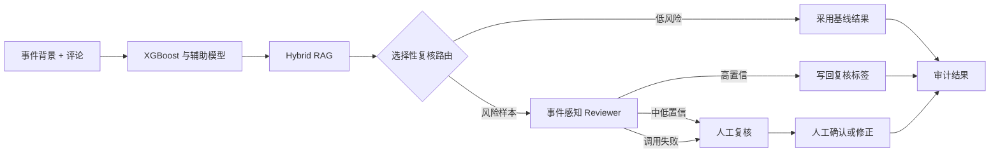
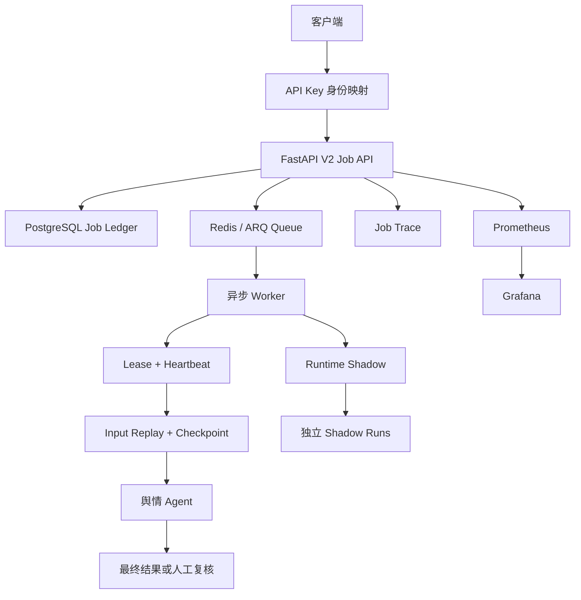

# 可复核中文舆情风险研判与 Agent 评测平台

[](https://github.com/KristenYue/public-opinion-agent-eval/actions/workflows/ci.yml)


面向中文舆情风险研判的可评测 Agent 系统。

项目从一个真实问题出发：旧情感分类器在原始数据切分上表现尚可，但遇到训练阶段未见事件、短文本、反讽和依赖事件背景的评论时，会出现明显的分布外失效。

系统通过**事件级评测、选择性自动化、Hybrid RAG、Reviewer 分级复核、人工兜底和审计 Trace**，限制模型错误直接进入最终结论。

> 核心目标不是追求一个脱离场景的单一准确率，而是识别哪些结果可以自动放行、哪些结果必须复核，并保留每次判断、修改和降级的完整证据。

**在线演示：** [魔搭创空间](https://modelscope.cn/studios/KristenYue/public-opinion-agent-demo)

---

## 10 秒了解项目

```text
事件背景 + 舆情评论
          │
          ▼
XGBoost 快速基线
          +
辅助模型与风险信号
          │
          ▼
Hybrid RAG 检索历史事件证据
          │
          ▼
选择性复核路由
    │               │
    │低风险         │分歧/低置信/短文本
    ▼               ▼
基线结果       事件感知 Reviewer
                    │
              ┌─────┴─────┐
              │高置信     │不确定/调用失败
              ▼           ▼
          自动写回      人工复核
              │           │
              └─────┬─────┘
                    ▼
       最终标签 + 证据 + 审计 Trace
```

工程化 V2 将上述流程封装为异步任务：

```text
FastAPI
  → PostgreSQL Job
  → Redis/ARQ Worker
  → Lease + Heartbeat
  → Checkpoint
  → Agent 执行
  → 人工复核或完成
  → Trace + Prometheus + Grafana
```

---

# 核心量化结果

| 验证维度 | 当前结果 | 说明 |
|---|---:|---|
| 跨事件评测数据 | **599 条、12 个事件** | 按事件隔离，不随机打散评论 |
| 最终测试集 | **339 条、6 个未见事件** | 测试事件不进入训练阶段 |
| XGBoost 基线 Accuracy | **31.27%** | 证明旧模型存在明显跨事件失效 |
| 事件感知纯自动 Accuracy | **56.05%** | 相比基线提升 24.78 个百分点 |
| 选择性自动 Accuracy | **66.67%** | 只统计系统决定自动处理的样本 |
| 自动覆盖率 | **78.76%** | 其余 21.24% 主动转人工 |
| 完整人机流程参考结果 | **73.75%** | 使用人工标签模拟人工接管结果 |
| Reviewer 修正基线错误 | **85 个** | 同一冻结测试集 |
| Harmful Override | **1 次** | Reviewer 将原本正确结果改错 |
| RAG 相关查询 | **16 条** | Recall/MRR/nDCG/Top-1 均为 100% |
| 无关查询 | **4 条** | 无关证据拒绝率为 75% |
| 检索污染查询 | **3 条** | Prompt Injection 污染拒绝率 100% |
| 安全治理门禁 | **10/10 通过** | 预算、白名单、脱敏和注入场景 |
| Runtime 成对门禁 | **60 对通过** | Baseline/Candidate 严格 Case 配对 |
| 工程化部署 | **八服务 Compose 通过** | API、Worker、数据库、队列和监控 |

> 上述指标均绑定仓库内冻结数据、阈值、脚本和评测口径，不代表生产 SLA、真实平台业务收益或所有中文舆情场景的泛化表现。

---

# 为什么做这个项目

## 旧模型的问题

本科阶段的 XGBoost 模型可以作为低成本快速基线，但其训练数据主要来自固定历史语料。

当输入切换到新事件时，容易出现：

- 未见话题词；
- 极短评论；
- 反讽或隐含立场；
- 必须结合事件背景才能理解；
- 文本清洗后有效特征过少；
- 大量样本退回 Neutral；
- 模型置信度与实际正确性不一致。

如果只使用随机评论切分，来自同一事件的相似表达可能同时进入训练集和测试集，使评测结果过于乐观。

因此项目将评测单位从“评论”提升到“事件”。

---

# 跨事件评测设计

## 事件级数据隔离

```text
12 个事件
    │
    ├── 训练事件
    ├── Validation 事件
    └── 6 个最终测试事件
```

同一个事件的评论只能属于一个 Split。

这避免：

```text
同一事件的相似文本
同时进入训练集和测试集
        ↓
模型通过事件关键词获得虚高结果
```

## 阈值冻结

Reviewer 置信度、自动放行和人工兜底阈值只在 Validation 数据上选择。

阈值锁定后，对 6 个未见事件、339 条测试评论只执行一次最终评测，不根据测试结果反复调参。

## 指标设计

同时报告：

- Accuracy；
- Macro-F1；
- Negative Recall；
- 自动覆盖率；
- 人工兜底比例；
- Reviewer 纠错数量；
- Harmful Override；
- Bootstrap 置信区间。

不只看总体准确率，还检查负面风险识别和自动化覆盖范围。

---

# 跨事件评测结果

| 评测口径 | Accuracy | Macro-F1 | Negative Recall |
|---|---:|---:|---:|
| XGBoost 基线 | **31.27%** | 26.17% | 17.36% |
| 事件感知纯自动流程 | **56.05%** | 45.13% | 57.64% |
| 选择性自动 | **66.67%** | 53.22% | 70.09% |
| 完整工作流参考结果 | **73.75%** | 62.65% | 75.69% |

纯自动流程相比基线：

```text
56.05% - 31.27% = +24.78 个百分点
```

纯自动 Accuracy 的评论级 Bootstrap 95% 置信区间：

```text
50.74% – 61.36%
```

Reviewer 在冻结测试集上：

```text
修正基线错误：85 个
Harmful Override：1 个
```

这说明 Reviewer 整体产生正向纠错，但不是零风险组件，因此仍需置信门禁与人工兜底。

详细结果见 [Benchmark v1.5](docs/BENCHMARK_V1_5_RESULTS.md)。

---

# 选择性自动化

系统不会要求所有样本都自动产生最终结论。

每条评论根据以下信号决定是否进入复核：

- XGBoost 低置信；
- XGBoost 与辅助模型分歧；
- 短文本；
- 事件背景依赖；
- 检索证据不足；
- Reviewer 置信度不足；
- 模型调用失败；
- 输出契约不完整。

决策流程：

```text
评论进入系统
      │
      ▼
基线模型与风险信号
      │
      ├── 低风险、一致、高置信
      │       └── 自动放行
      │
      └── 分歧、低置信、短文本
              └── Reviewer
                    │
                    ├── 高置信 → 自动写回
                    └── 不确定 → manual_required
```

当前冻结测试集结果：

```text
自动覆盖率：78.76%
人工兜底比例：21.24%
选择性自动 Accuracy：66.67%
```

选择性自动的 66.67% 只代表系统主动选择自动处理部分的准确率，不是全量测试集准确率。

完整工作流的 73.75% 使用人工标签模拟被转人工样本的最终结果，它是人机协作流程的参考上限，不是模型独立准确率。

---

# Hybrid RAG 证据检索

## 检索链路

```text
当前事件与评论
      │
      ├── 稀疏检索：关键词与事件实体
      ├── 稠密检索：语义相似度
      └── Hybrid 融合排序
              │
              ▼
       证据相关性门禁
              │
              ├── 相关 → 提供给 Reviewer
              └── 不相关 → 拒绝引用
```

检索结果不会直接作为事实结论。

系统会保留：

- 证据来源事件；
- 排名；
- 相似度；
- 检索方式；
- 是否通过相关性门禁；
- 最终是否被 Reviewer 引用。

## RAG 专项评测

公开合成 `rag_eval_v1` 包含：

| 类型 | 数量 |
|---|---:|
| 相关性查询 | **16** |
| 无关查询 | **4** |
| Prompt Injection 污染查询 | **3** |

当前结果：

| 指标 | 结果 |
|---|---:|
| Recall@5 | **100%** |
| MRR@5 | **100%** |
| nDCG@5 | **100%** |
| Top-1 引用正确率 | **100%** |
| 无关证据拒绝率 | **75%** |
| 检索污染拒绝率 | **100%** |

项目保留了一个真实失败案例：

```text
查询：快速排序算法
错误命中：配送算法规则调整
```

该案例说明关键词重叠可能导致无关证据进入候选列表，因此无关证据拒绝仍是后续优化重点。

完整结果见 [RAG 评测 V1](docs/RAG_EVALUATION_V1.md)。

---

# Agent 状态与审计链路

核心 Agent 使用 LangGraph 状态图。



`AgentState` 保存：

- 输入事件；
- 评论列表；
- 基线输出；
- 辅助模型输出；
- 检索证据；
- Reviewer 结果；
- 置信度；
- 风险原因；
- 工具调用 Trace；
- 人工复核状态；
- 最终标签；
- 降级原因；
- 简报结果。

因此最终结果能够回答：

- 为什么使用基线标签；
- 为什么触发 Reviewer；
- Reviewer 为什么覆盖旧结果；
- 为什么转入人工；
- 使用了哪些证据；
- 哪个模型或工具失败；
- 人工修改了什么；
- 最终结论由谁产生。

---

# 人工复核闭环

当任务进入：

```text
manual_required
```

人工可以逐条：

- 查看原始评论；
- 查看模型预测；
- 查看 Reviewer 建议；
- 查看置信度；
- 查看历史事件证据；
- 修改最终标签；
- 填写复核意见；
- 重新生成风险简报。

人工修改不会只停留在页面展示，而会写回任务状态并进入审计轨迹。

状态变化：

```text
manual_required
      ↓
人工确认或修正
      ↓
human_completed
      ↓
重新生成最终简报
```

---

# Reviewer 风险控制

Reviewer 不是无条件覆盖基线。

只有满足以下条件时才能自动写回：

- 输出结构符合契约；
- 标签属于允许集合；
- 置信度达到门槛；
- 没有安全标记；
- 事件和评论 ID 对齐；
- 证据满足最低要求。

否则进入人工复核。

## Harmful Override

项目专门记录：

```text
Reviewer 将错误答案改正确
```

以及：

```text
Reviewer 将正确答案改错误
```

后者定义为 `harmful_override`。

当前冻结测试集：

```text
纠正基线错误：85
Harmful Override：1
```

这比只报告“Reviewer 使用率”更能反映复核组件的真实风险。

---

# 安全治理

V1、V2 和 MCP 入口共享安全策略。

## 输入边界

- 请求字符预算；
- 评论数量限制；
- 字段长度限制；
- 敏感信息脱敏；
- 不可信指令检测；
- 非法工具轨迹拒绝。

## 工具治理

- 工具白名单；
- 最大工具调用次数；
- 未知工具失败关闭；
- 超预算失败关闭；
- 高风险操作必须人工确认；
- 不将检索文本解释为系统指令。

## 安全门禁结果

离线安全治理套件覆盖 10 个场景：

```text
10/10 通过
```

包括：

- 字符预算；
- 工具白名单；
- 工具调用预算；
- 人工确认策略；
- 敏感文本脱敏；
- Prompt Injection；
- 未知工具；
- 非法 Trace；
- 失败关闭；
- 降级处理。

详细说明见 [V2 安全治理](docs/V2_SECURITY_GOVERNANCE.md)。

---

# V2 可靠异步任务平台

V2 将单进程 Agent 扩展为持久化任务系统。



## V2 任务能力

- 幂等任务提交；
- PostgreSQL 审计账本；
- Redis/ARQ 异步执行；
- Lease 与 Heartbeat；
- 输入 Checkpoint；
- Worker 异常恢复；
- 人工复核状态；
- Project 级权限；
- 任务 Trace；
- Runtime Shadow；
- Prometheus 指标；
- Grafana Dashboard。

---

# 幂等任务提交

客户端提交 V2 任务时必须携带：

```text
Idempotency-Key
X-API-Key
```

服务端将：

```text
Project + Idempotency-Key
```

映射到同一个任务。

相同请求重放时：

- 不创建第二个 Job；
- 返回原 Job；
- 响应头标记幂等重放；
- 保留可信请求主体。

这避免客户端超时重试产生重复任务。

---

# 身份与 Project 权限

V2 使用部署 Secret 提供：

```text
Token → Subject
```

映射。

请求中的 `requested_by` 不作为可信身份，服务端会使用认证后的 Subject 覆盖客户端值。

Project 角色包括：

| 角色 | 权限 |
|---|---|
| `owner` | 提交任务、读取任务、管理受信成员 |
| `analyst` | 提交任务和读取结果 |
| `viewer` | 读取所属 Project 的任务与 Trace |

未配置认证信息时，V2 Durable API 不会退回匿名模式。

---

# Runtime Shadow

项目可以将正式执行结果与新 Runtime Candidate 进行隔离比较。

```text
正式 Job
   │
   ├── 正式结果 → Job Result
   │
   └── Shadow Candidate → shadow_runs
```

Shadow 结果：

- 不覆盖正式结果；
- 不改变用户可见状态；
- 不触发外部副作用；
- 独立保存质量、错误、延迟和成本；
- 可通过关闭开关快速回滚。

默认：

```text
RUNTIME_SHADOW_ENABLED=false
```

## Runtime 成对门禁

公开套件包含：

```text
60 个合成场景
6 类 × 每类 10 个
```

Baseline 与 Candidate 必须严格匹配：

- `case_id`
- 任务分类
- 输入版本
- 数据哈希

门禁同时比较：

- 成功率；
- 质量分；
- 错误数；
- 工具调用；
- 延迟；
- 估算成本。

当前：

```text
60 对成对门禁通过
```

报告见 [Runtime 评测](data/evaluation/runtime_eval_report_v1.json)。

---

# 八服务部署拓扑

Docker Compose 包含：

1. `postgres`
2. `redis`
3. `migrate`
4. `bootstrap`
5. `api`
6. `worker`
7. `prometheus`
8. `grafana`

CI 会真实执行：

```text
解析 Compose 配置
    ↓
构建 V2 镜像
    ↓
启动八个服务
    ↓
执行数据库迁移
    ↓
初始化 Project
    ↓
验证未认证请求被拒绝
    ↓
提交带身份和幂等键的 Job
    ↓
等待 Worker 完成
    ↓
验证幂等重放
    ↓
读取 Job Trace
    ↓
检查 Prometheus 与 Grafana
    ↓
清理临时 Volume
```

---

# 快速运行

## 环境要求

- Python 3.11 或 3.12
- Git
- 可选：Docker 与 Docker Compose
- 可选：OpenAI 兼容 LLM API

## 1. 安装 Demo 与测试依赖

### Windows PowerShell

```powershell
python -m venv .venv
.\.venv\Scripts\python.exe -m pip install -e ".[demo,dev]"
```

### Linux

```bash
python -m venv .venv
.venv/bin/python -m pip install -e '.[demo,dev]'
```

## 2. 运行测试

### Windows

```powershell
.\.venv\Scripts\python.exe -m pytest -q
```

### Linux

```bash
.venv/bin/python -m pytest -q
```

## 3. 启动 Gradio Demo

```powershell
.\.venv\Scripts\python.exe app.py
```

打开：

```text
http://127.0.0.1:7860
```

Demo 支持：

- 预置快速放行路径；
- Reviewer 复核路径；
- 人工兜底路径；
- 人工修改标签；
- 重新生成简报。

没有 LLM Key 时，陌生或争议输入会明确转为：

```text
manual_required
```

不会伪造在线模型结果。

## 4. 启动 FastAPI Console

```powershell
.\.venv\Scripts\python.exe scripts\run_public_demo.py --port 8000
```

打开：

```text
http://127.0.0.1:8000/console
```

主要接口：

| 方法 | 路径 | 用途 |
|---|---|---|
| `POST` | `/v1/analyze` | 执行舆情研判 |
| `GET` | `/health` | 存活检查 |
| `GET` | `/ready` | 依赖就绪检查 |

---

# 配置可选 LLM Reviewer

项目通过 OpenAI 兼容接口调用可选 Reviewer，不在仓库或镜像中保存 Key。

```powershell
$env:LLM_BASE_URL = "https://your-provider.example/v1"
$env:LLM_API_KEY = "replace-me"
$env:LLM_MODEL = "your-model"

.\.venv\Scripts\python.exe app.py
```

阿里云百炼兼容接口示例：

```powershell
$env:LLM_BASE_URL = "https://dashscope.aliyuncs.com/compatible-mode/v1"
$env:LLM_API_KEY = "通过平台 Secret 注入"
$env:LLM_MODEL = "qwen-plus"
```

未配置时，系统使用可审计的人工兜底路径。

---

# 启动 V2 八服务环境

安装生产与 Shadow 依赖：

```powershell
.\.venv\Scripts\python.exe -m pip install -e ".[production,shadow,dev]"
```

设置本地 Secret：

```powershell
$env:POSTGRES_PASSWORD = "请替换为随机强密码"
$env:GRAFANA_ADMIN_PASSWORD = "请替换为另一个随机强密码"
$env:V2_AUTH_TOKENS_JSON = '{"local-token":"local-owner"}'
$env:V2_PROJECT_CREATED_BY = "local-owner"
```

启动：

```powershell
docker compose up --build
```

默认服务：

| 服务 | 地址 |
|---|---|
| V2 API | `http://127.0.0.1:8000` |
| Job Trace 页面 | `http://127.0.0.1:8000/trace` |
| Prometheus | `http://127.0.0.1:9090` |
| Grafana | `http://127.0.0.1:3000` |

关闭并清理：

```powershell
docker compose down --volumes --remove-orphans
```

详细部署步骤见 [V2 部署文档](docs/V2_DEPLOYMENT.md)。

---

# V2 API

| 方法 | 路径 | 用途 |
|---|---|---|
| `POST` | `/v2/jobs` | 幂等创建异步研判任务 |
| `GET` | `/v2/jobs/{job_id}` | 查询任务状态和结果 |
| `GET` | `/v2/jobs/{job_id}/trace` | 查询执行、恢复和复核 Trace |

Job Trace 包含：

- Job 当前状态；
- 执行尝试；
- Worker；
- Checkpoint；
- 工具调用；
- 恢复原因；
- 人工复核；
- Shadow 结果；
- 错误与降级路径。

---

# 运行评测门禁

## 跨事件评测

```powershell
.\.venv\Scripts\python.exe scripts\evaluate_event_aware_cascade.py `
  --queue data\evaluation\benchmark_v1_5_queue.jsonl `
  --reviews data\evaluation\benchmark_v1_5_reviews.jsonl `
  --qwen-responses data\evaluation\benchmark_v1_5_qwen_responses.jsonl `
  --output data\evaluation\benchmark_v1_5_final_metrics.json
```

## RAG 评测

```powershell
.\.venv\Scripts\python.exe scripts\evaluate_rag_v1.py
```

## 安全治理

```powershell
.\.venv\Scripts\python.exe scripts\evaluate_security_governance.py
```

## Runtime 成对门禁

```powershell
.\.venv\Scripts\python.exe scripts\evaluate_runtime_gate.py
```

## 发布就绪检查

```powershell
.\.venv\Scripts\python.exe scripts\check_release_readiness.py
```

---

# 持续集成

GitHub Actions 包含三个独立任务。

| CI 任务 | 验证内容 |
|---|---|
| `test-and-release-check` | 回归测试、RAG、安全治理、Runtime 门禁、Wheel 和发布检查 |
| `postgres-redis-integration` | Migration、Project 初始化与真实数据库/队列生命周期 |
| `compose-smoke` | 八服务构建、认证、幂等 Job、Trace 和监控 |

测试流水线还会：

- 构建 Python Wheel；
- 检查 Wheel 是否包含静态文件和 Migration；
- 在干净目录安装 Wheel；
- 检查公开包能否正常导入；
- 验证发布文件范围；
- 防止文档与真实实现发生漂移。

---

# 真实 Bad Case 与工程闭环

## BC-001：有效短文本被清洗为空

### 现象

Benchmark v1.5 首次正式运行时，3 条有效短文本经过旧 XGBoost 预处理后变为空字符串，程序在生成最终指标前中止。

### 根因

旧模型预处理规则与新的事件级工作流边界不一致。

### 修复

- 不删除样本；
- 不修改人工标签；
- 将其显式标记为 `Unscorable`；
- 置信度设为 `0.0`；
- 继续进入风险路由；
- 由 Reviewer 或人工处理。

该修复保留了数据完整性，避免通过删除困难样本提高指标。

---

## BC-002：Grafana 启动期连接重置

### 现象

Compose 中 Grafana 容器已经启动，但健康检查首次访问时发生 `ConnectionResetError`。

### 根因

健康检查轮询只捕获 HTTP、URL 和超时异常，没有覆盖服务启动阶段的连接级瞬态。

### 修复

- 将 `ConnectionError` 加入可重试集合；
- 保持 `KeyError` 等契约错误立即失败；
- 增加“第一次连接重置、第二次成功”的行为测试。

---

## BC-003：HTTP Header 大小写误判

### 现象

V2 Job 成功返回 `202 Accepted`，但 Compose Smoke 误判幂等创建失败。

### 根因

HTTP Header 不区分大小写，但测试客户端将 Header 转为普通大小写敏感字典。

服务返回：

```text
idempotency-replayed
```

脚本查找：

```text
Idempotency-Replayed
```

### 修复

在 HTTP 客户端边界统一将 Header 名规范化为小写，并保留首个请求必须为 `false`、重放必须为 `true` 的严格断言。

---

## BC-004：预期的 401 被测试客户端当作脚本失败

### 现象

认证冒烟测试预期匿名请求返回 401，但 Python `urllib` 将非 2xx 响应抛为异常，导致脚本无法继续检查状态码和响应体。

### 修复

在公共 HTTP 客户端边界捕获 `HTTPError`，保留：

- 状态码；
- 响应头；
- 响应体。

随后继续严格断言：

```text
无 Token → 401
有效 Token → 允许继续
```

这些失败均保留在 [V2 工程日志](docs/V2_ENGINEERING_LOG.md) 中，没有通过删除断言或跳过检查换取绿色 CI。

---

# 工程证据索引

| 想了解的内容 | 对应文档 |
|---|---|
| 当前系统架构 | [架构说明](docs/ARCHITECTURE.md) |
| 跨事件最终结果 | [Benchmark v1.5](docs/BENCHMARK_V1_5_RESULTS.md) |
| RAG 评测协议与结果 | [RAG 评测](docs/RAG_EVALUATION_V1.md) |
| Reviewer 策略 | [Reviewer Policy](docs/REVIEWER_POLICY_VALIDATION_PROTOCOL.md) |
| Reviewer 验证结果 | [Reviewer Results](docs/REVIEWER_POLICY_VALIDATION_RESULTS.md) |
| Agent 评测方法 | [Agent Evaluation](docs/AGENT_EVALUATION.md) |
| V2 API | [V2 API](docs/V2_API.md) |
| V2 部署 | [V2 Deployment](docs/V2_DEPLOYMENT.md) |
| V2 恢复语义 | [V2 Recovery](docs/V2_RECOVERY.md) |
| 完整工程过程 | [V2 Engineering Log](docs/V2_ENGINEERING_LOG.md) |
| 架构决策 | [Decisions](docs/DECISIONS.md) |
| 数据边界 | [Data Card](DATA_CARD.md) |
| 安全说明 | [Security](SECURITY.md) |
| 当前文档导航 | [Docs Index](docs/README.md) |

---

# 仓库结构

```text
public-opinion-agent-eval/
├── app.py                             # Gradio Demo
├── src/opinion_agent/
│   ├── agent/                         # LangGraph 状态与条件路由
│   ├── retrieval/                     # Sparse、Dense 与 Hybrid RAG
│   ├── sentiment/                     # XGBoost、辅助与 Transformer
│   ├── evaluation/                    # 跨事件、RAG、安全与 Runtime 评测
│   ├── v2/                            # Job API、Worker、Lease、Trace 与 RBAC
│   ├── api.py                         # V1 FastAPI
│   ├── governance.py                  # 安全治理
│   ├── observability.py               # 指标与 Trace
│   └── mcp_server.py                  # MCP 工具入口
├── data/evaluation/                    # 冻结指标、Manifest 与报告
├── examples/                           # Demo、RAG 与 Runtime 合成输入
├── scripts/                            # 评测、训练、Migration 和发布检查
├── tests/                              # 单元、契约、恢复和集成测试
├── docs/                               # 架构、协议、日志与决策
├── deploy/                             # Prometheus 与 Grafana
├── Dockerfile                          # V1 Demo
├── Dockerfile.v2                       # V2 服务镜像
├── compose.yaml                        # 八服务拓扑
└── .github/workflows/ci.yml
```

---

# 项目证明的工程能力

本项目技术亮点：

- 识别模型在分布外事件上的失效；
- 使用事件级数据切分降低信息泄漏；
- 冻结 Validation 阈值后执行最终测试；
- 使用 Accuracy、Macro-F1、Recall 和置信区间评价模型；
- 使用选择性自动化主动拒绝不确定样本；
- 将 Reviewer 纠错与 Harmful Override 同时量化；
- 使用 Hybrid RAG 提供历史事件证据；
- 对无关证据和检索 Prompt Injection 建立专项门禁；
- 建立可修改、可回写的人工复核闭环；
- 使用 LangGraph 保存结构化 Agent 状态；
- 使用 PostgreSQL 和 Redis 构建异步任务链；
- 使用 Lease、Heartbeat 和 Checkpoint 支持任务恢复；
- 使用 Runtime Shadow 隔离候选版本；
- 使用 Prometheus、Grafana 和 Trace 建立可观测性；
- 将真实 Bad Case 固化为自动化回归测试；
- 使用冻结数据和机器可读报告建立发布质量门禁。

---

## 项目边界

- 公开 Demo 使用合成事件卡，不公开原始微博语料、Cookie、API Key 或用户标识；
- 历史检索证据用于提供上下文，不直接证明事件因果关系；
- 未完成复核的争议评论不会直接作为最终业务结论；
- 无 LLM Key 或模型调用失败时，系统明确进入人工复核；
- 完整人机流程指标不是模型独立准确率；
- 跨事件评测结果只适用于当前冻结数据、阈值和版本；
- 八服务 Compose 结果证明工程链路可执行，不代表生产容量或 SLA。

## 开源许可

第三方依赖及模型资产说明见 [THIRD_PARTY_NOTICES.md](THIRD_PARTY_NOTICES.md)。项目公开范围与上游来源见 [UPSTREAM.md](UPSTREAM.md)。
