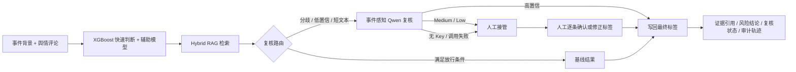

# 可复核中文舆情风险研判 Agent

> **识别本科模型的分布外失效，通过事件感知路由、上下文推理与分级复核，把旧模型升级为可靠系统。**

> **Production V2 开发说明：** 冻结 V1 已标记为
> `v1.0-frozen-2026-09-11`；`production-v2` 已完成 PostgreSQL/Redis 异步任务、
> lease/heartbeat 恢复、默认关闭的 Runtime Shadow、组合质量门禁和 Job Trace 查看器。
> 完整八服务 Compose 链路已由 [Actions run `38899760131`](https://github.com/KristenYue/public-opinion-agent-eval/actions/runs/38899760131)
> 构建并通过携带临时 CI Token 的公共 API 冒烟；这是托管 Linux runner 的合成验证，不是生产 SLA。
> 当前系统拓扑见 [`docs/ARCHITECTURE.md`](docs/ARCHITECTURE.md)，API 契约见
> [`docs/V2_API.md`](docs/V2_API.md)，问题与解决过程见
> [`docs/V2_ENGINEERING_LOG.md`](docs/V2_ENGINEERING_LOG.md)，恢复语义与边界见
> [`docs/V2_RECOVERY.md`](docs/V2_RECOVERY.md)，阶段路线校准见
> [`docs/V2_ROADMAP_ALIGNMENT_2026-10-15.md`](docs/V2_ROADMAP_ALIGNMENT_2026-10-15.md)。

**在线 Demo：** [魔搭创空间（已验收的面试展示版）](https://modelscope.cn/studios/KristenYue/public-opinion-agent-demo)

项目主线： [冻结模型基座：chinese-sentiment-analysis-thesis](https://github.com/KristenYue/chinese-sentiment-analysis-thesis) → **生产级业务应用：本仓库** → [通用执行内核：agent-runtime-quality-platform](https://github.com/KristenYue/agent-runtime-quality-platform)。旧的 [agent-reliability-eval](https://github.com/KristenYue/agent-reliability-eval) 只保留为早期评测来源，不再代表当前运行时架构。

## 为什么做这个项目

本科毕设 XGBoost 在原数据分布内可作为快速基线，但在新事件、短文本和上下文依赖评论上会退回 Neutral。系统保留该模型作为快速路，同时用辅助模型分歧、XGBoost 低置信和短文本风险逐条触发事件感知 Qwen 复核；Qwen 只有在高置信时才能形成自动最终标签，否则进入人工兜底。每次升级原因、模型输出、最终标签和决策路径均保留用于审计。

## 5 项可复现核心证据

| 证据 | 结果 | 口径与入口 |
|---|---:|---|
| 跨事件数据边界 | 599 条、12 个事件；最终测试 339 条、6 个未见事件 | 事件级隔离、阈值只在 validation 锁定；见 [Benchmark v1.5](docs/BENCHMARK_V1_5_RESULTS.md) |
| 纯自动级联 | Accuracy 31.27% → 56.05%（+24.78 个百分点） | 同一冻结未见事件测试集；不是生产流量指标 |
| 选择性自动 | 66.67% Accuracy，自动覆盖率 78.76% | 只统计系统选择自动处理的样本；66.67% 不是全量准确率 |
| RAG 专项门禁 | 16 条相关查询 Recall@5/MRR@5/nDCG@5/Top-1 均为 100%；4 条无关查询拒绝率 75% | 小规模公开合成集；保留 1 个误命中案例；见 [RAG 评测 V1](docs/RAG_EVALUATION_V1.md) |
| Runtime 与部署闭环 | 60 对版本化 case 门禁通过；八服务 Compose 冒烟通过 | 合成契约校准与临时 CI Token，不代表生产 SLA；见 [Runtime 报告](data/evaluation/runtime_eval_report_v1.json) 和 [CI 证据](https://github.com/KristenYue/public-opinion-agent-eval/actions/runs/38899760131) |

> 指标对应附件所述实验口径，不代表生产 SLA 或线上业务收益。
> Benchmark v1.5 中，旧 XGBoost 在 6 个未见事件、339 条测试评论上的 Accuracy 为 31.27%；事件感知纯自动流程提升至 56.05%（+24.78 个百分点）。这说明旧模型只适合作为基线信号，不能直接承担最终裁决。旧切分上 83.9% 的 Transformer 结果不作为跨事件泛化声明。

### 这些数字应该怎样理解

| 数字 | 测试条件 | 能说明什么 | 不能说明什么 |
|---|---|---|---|
| 31.27% → 56.05% | 6 个训练阶段未见事件、339 条评论；阈值预先锁定 | 加入事件背景、风险路由和 Qwen 复核后，纯自动流程优于旧基线 | 不能外推到所有平台、事件或生产流量 |
| 66.67% / 78.76% | 只统计系统选择自动处理的样本 / 自动处理比例 | 在主动放弃不确定样本后，自动结果更可靠 | 66.67% 不是全量样本准确率 |
| 73.75% | 21.24% 样本使用人工标签模拟接管 | 完整人机工作流的上限参考 | 不是模型准确率，也不是线上人工团队实测 SLA |
| 85 / 1 | 同一冻结测试集上的纠错数 / 把原本正确结果改错的次数 | Reviewer 大多数覆盖有正收益，但并非零风险 | 小样本不能证明长期风险率 |

## 架构



核心实现位于 `src/opinion_agent/agent/`。Graph 使用 TypedDict `AgentState` 保存中间结果、工具轨迹和降级状态。

## 我的工作与复用边界

- **我完成的部分：** LangGraph 状态与条件路由、XGBoost/辅助模型/Qwen 的分级门禁、Hybrid RAG 证据筛选、人工复核闭环、审计轨迹、跨事件评测、故障注入、发布检查和 Demo。
- **复用的部分：** 本科毕设训练得到的 XGBoost 资产；LangGraph、FastAPI、Gradio、BGE 等开源库；通过兼容接口调用的 Qwen 模型。
- **不做的归功：** 不把开源框架、基础模型或本科原始模型全部声称为本项目新代码；公开 Demo 仅使用合成事件卡，原始微博语料不公开。
- 代码入口与证据对应关系见 `src/opinion_agent/`、`tests/`、`scripts/` 和 `data/evaluation/`，便于面试时从结论追到实现与原始结果。

## 如何复现

### 环境

- Python 3.11 或 3.12
- 无需 API Key 即可使用合成事件卡运行；预置样例同时展示快速放行、离线验收回放和人工兜底
- 修改预置评论、目标或背景后会自动启用严格复核；无在线 Key 时陌生输入明确转人工
- 首次启用语义检索会下载 `BAAI/bge-small-zh-v1.5`

### 安装与测试

```powershell
python -m venv .venv
.\.venv\Scripts\python.exe -m pip install -e ".[demo,dev]"
.\.venv\Scripts\python.exe -m pytest -q
```

### 启动 Gradio Demo

```powershell
.\.venv\Scripts\python.exe app.py
```

打开 `http://127.0.0.1:7860`。稳定演示模式展示预置样例的三条决策路径；现场自由测试模式会强制所有评论进入 Reviewer。即使忘记切换模式，只要修改预置评论、目标或背景，也会自动采用严格策略。若触发人工复核，可在工作台修改最后一列标签，再点击“应用人工复核并重新生成简报”；状态会更新为 `human_completed`。

网络异常时可直接播放 [3 分钟离线演示视频](docs/舆情研判Agent_3分钟离线演示.mp4)；逐字稿与操作顺序见 [3 分钟面试 Demo 讲解稿](docs/INTERVIEW_DEMO_SCRIPT.md)。

### 跨事件评测门禁

Benchmark v1.5 共冻结 599 条上下文标注、12 个事件。评测脚本会检查“整个事件只属于一个 split”、人工标注是否完整，以及 validation/test 的盲态 Qwen 响应是否齐全。阈值只在 35 条 validation 数据上选择，锁定后对 6 个未见事件、339 条 test 数据只评一次：

```powershell
.\.venv\Scripts\python.exe scripts\evaluate_event_aware_cascade.py `
  --queue data\evaluation\benchmark_v1_5_queue.jsonl `
  --reviews data\evaluation\benchmark_v1_5_reviews.jsonl `
  --qwen-responses data\evaluation\benchmark_v1_5_qwen_responses.jsonl `
  --output data\evaluation\benchmark_v1_5_final_metrics.json
```

最终测试结果：

| 口径 | Accuracy | Macro-F1 | Negative Recall |
|---|---:|---:|---:|
| XGBoost 基线 | 31.27% | 26.17% | 17.36% |
| 纯自动事件感知级联 | 56.05% | 45.13% | 57.64% |
| 选择性自动（自动覆盖 78.76%） | 66.67% | 53.22% | 70.09% |
| 完整工作流（含 21.24% 人工兜底） | 73.75% | 62.65% | 75.69% |

纯自动 Accuracy 的评论级 bootstrap 95% CI 为 50.74%–61.36%。Qwen 共修正 85 个 XGBoost 错误，产生 1 次 harmful override。完整工作流使用人工标签模拟人工接管后的结果，**不能称为模型准确率**。详见 [Benchmark v1.5 最终结果](docs/BENCHMARK_V1_5_RESULTS.md)；旧版 80 条测试结果保留在 [事件感知跨事件评测](docs/EVENT_AWARE_EVALUATION.md) 中作为历史记录。

### 启动 FastAPI Console

```powershell
.\.venv\Scripts\python.exe scripts\run_public_demo.py --port 8000
```

打开 `http://127.0.0.1:8000/console`。API 请求示例：

```json
{
  "event_id": "关税",
  "query": "分析关税事件评论，并检索可信的历史相似事件",
  "comments": [
    {"sample_id": "demo-1", "text": "普通消费者最后还是要承担更高成本"},
    {"sample_id": "demo-2", "text": "先看看后续具体实施细则"}
  ]
}
```

接口为 `POST /v1/analyze`，存活检查为 `GET /health`，依赖就绪检查为 `GET /ready`。

### 冻结 RAG 专项门禁

公开合成 `rag_eval_v1` 包含 16 条相关性查询、4 条无关查询和 3 条检索污染查询。当前离线 Guarded TF-IDF 基线的 Recall@5、MRR@5、nDCG@5 与 Top-1 引用正确率均为 100%，无关证据拒绝率为 75%，Prompt Injection 污染拒绝率为 100%。这些数字只适用于小规模公开合成集，不能外推为生产流量表现；保留的失败案例是“快速排序算法”误命中“配送算法规则调整”。详见 [RAG 评测 V1](docs/RAG_EVALUATION_V1.md)。

### 安全治理门禁

V1、V2 和 MCP 入口共享请求字符预算与敏感文本脱敏；Worker 落库前验证工具白名单和最大调用次数，未知工具或超预算轨迹会 `failed_closed`。离线安全门禁覆盖 10 个预算、白名单、人工确认、脱敏和注入场景，目前为 10/10 通过。当前生产图没有副作用工具，危险操作确认只是经过测试的策略能力，不声称已经存在审批 UI。详见 [V2 安全治理](docs/V2_SECURITY_GOVERNANCE.md)。

### Production V2 异步任务链路

V2 保留 V1 接口，同时增加幂等异步任务 API、PostgreSQL 审计账本、Redis/ARQ Worker、执行租约与输入检查点重放。使用 Compose 启动前必须提供数据库密码：

```powershell
$env:POSTGRES_PASSWORD="请替换为随机强密码"
$env:GRAFANA_ADMIN_PASSWORD="请替换为另一个随机强密码"
$env:V2_AUTH_TOKENS_JSON='{"请替换为随机长Token":"local-owner"}'
$env:V2_PROJECT_CREATED_BY="local-owner"
docker compose up --build
```

默认项目 ID 为 `11111111-1111-1111-1111-111111111111`。提交任务时调用 `POST /v2/jobs`，携带 `Idempotency-Key` 与 `X-API-Key` 请求头，并在请求体中使用该 `project_id`；服务端会以 token 映射的可信 subject 覆盖客户端 `requested_by`。Prometheus 默认在 9090，预配置的 Grafana 面板默认在 3000。部署拓扑、启动命令、验收步骤和限制见 [V2 部署与集成测试](docs/V2_DEPLOYMENT.md)；完整实现过程见 [V2 工程日志](docs/V2_ENGINEERING_LOG.md)。

任务提交后可调用 `GET /v2/jobs/{job_id}` 查看当前状态，调用 `GET /v2/jobs/{job_id}/trace` 读取按尝试排序的 Run、检查点、工具调用、恢复原因、人工复核和隔离 Shadow 记录。浏览器打开 `http://127.0.0.1:8000/trace`，输入 Job ID 即可查看完整生命周期；`manual_required` 在页面中明确显示为“暂停 · 等待人工复核”，`retrying` 会显示恢复次数与上一次运行的 `recovery_reason`。

Runtime Platform shadow 比较路径已经接线，但通过 `RUNTIME_SHADOW_ENABLED=false` 默认关闭。开启时 candidate 结果只进入独立 `shadow_runs`，不会覆盖正式 Job 结果；关闭并重启 Worker 即可回滚。启用方法、成本边界与数据库前置条件见部署文档。

### Runtime 成对回归门禁

公开 `runtime-opinion-v1` 套件包含 60 个合成场景，六类各 10 个。CI 使用固定 Runtime Platform 提交对 baseline/candidate 记录进行严格 case 配对，并同时检查成功率、质量、错误、延迟与估算成本。当前报告为合成契约校准：故障场景的成功表示预期隔离行为被满足，延迟和成本也是校准值，不能表述为生产流量或 SLA 证据。

```powershell
\.venv\Scripts\python.exe -m pip install -e ".[shadow,dev]"
\.venv\Scripts\python.exe scripts\evaluate_runtime_gate.py
```

冻结任务、成对记录与机器可读报告分别位于 `examples/runtime_eval_*_v1.jsonl` 和 `data/evaluation/runtime_eval_report_v1.json`。

## 可选 LLM Reviewer

项目使用 OpenAI 兼容接口，通过环境变量注入配置，不在代码或镜像中保存 Key：

```powershell
$env:LLM_BASE_URL="https://your-provider.example/v1"
$env:LLM_API_KEY="replace-me"
$env:LLM_MODEL="your-model"
.\.venv\Scripts\python.exe app.py
```

未配置变量时，争议样本会返回 `manual_required`，随后可在页面完成真实人工复核；这是一条可审计的降级路径，不是模拟 LLM 输出。

阿里云百炼兼容接口示例：

```powershell
$env:LLM_BASE_URL="https://dashscope.aliyuncs.com/compatible-mode/v1"
$env:LLM_API_KEY="通过平台 Secret 注入，不写入仓库"
$env:LLM_MODEL="qwen-plus"
```

## Docker 与公开部署

V1 面试 Demo 使用根目录 `Dockerfile`，只启动 Gradio：

```powershell
docker build -t opinion-agent-demo .
docker run --rm -p 7860:7860 opinion-agent-demo
```

V2 生产形态使用 `Dockerfile.v2` 与 `compose.yaml`，包含 PostgreSQL、Redis、migration、bootstrap、API、Worker、Prometheus 和 Grafana；启动命令与冒烟验收见 [V2 部署文档](docs/V2_DEPLOYMENT.md)。Hugging Face Spaces 和魔搭创空间的 V1 展示部署步骤见 [Demo 部署文档](docs/DEPLOYMENT.md)。两条路径用途不同，不应把单容器 Demo 当成 V2 后端。

## 目录结构

```text
app.py                         Gradio 在线 Demo 入口
src/opinion_agent/agent/       LangGraph 状态、节点与条件路由
src/opinion_agent/v2/          Job API、Worker、租约恢复、Trace 与 Shadow 接线
src/opinion_agent/retrieval/   TF-IDF、语义与 Hybrid RAG
src/opinion_agent/sentiment/   情感模型与第二信号
src/opinion_agent/api.py       FastAPI 入口
Dockerfile.v2 / compose.yaml   V2 镜像与八服务本地拓扑
deploy/                        Prometheus、Grafana 与数据库初始化配置
examples/                      合成事件卡与离线案例
scripts/                       评测、发布检查、migration 与 Compose 冒烟
tests/                         工作流、API、恢复、部署与发布检查
docs/                          当前文档索引、历史检查点与完整工程日志
```

## 一个真实失败案例

Benchmark v1.5 首次正式运行时，3 条有效短文本经旧 XGBoost 预处理后变成空字符串，程序在产生任何最终指标前中止。定位后发现问题不是样本无效，而是旧模型的文本清洗边界没有与生产工作流对齐。修复方式是：将此类输入显式记为 `Unscorable`、置信度设为 `0.0`，保留样本并继续走风险路由。整个过程中没有删除样本、改标签、改 Prompt 或看完测试结果后调阈值。完整记录见 [Benchmark v1.5 最终结果](docs/BENCHMARK_V1_5_RESULTS.md#生产一致性修正)。

## 术语的白话解释

| 术语 | 面试时可以这样说 |
|---|---|
| 分布外 / 未见事件 | 模型训练时没见过的新话题，原来的规律可能不再适用 |
| harmful override（有害覆盖） | 大模型复核把原本正确的答案改错了 |
| 失败关闭 | 系统不确定时不装作成功，而是明确停止并交给人工 |
| 人工闭环 | 人工不仅看结果，还能修改标签，修改后的结论会写回状态并重新生成简报 |
| Hybrid RAG | 先用关键词和语义两种方式找历史证据，再用门禁判断证据是否真的相关 |

## 版本边界

`v1.0-frozen-2026-09-11` 只冻结 V1 基线；当前 `production-v2` 已完成 P0–P3 交付包装，后续只处理认证/Project 级授权、许可证决策、错误修复和证据维护，不继续扩建 Runtime 内核或 Multi-Agent。V1 当时的核验边界见 [历史冻结记录](docs/PROJECT_FREEZE_2026-09-11.md)，当前状态与文档入口见 [文档导航](docs/README.md)。

## 数据、安全与限制

- 公开 Demo 只使用合成事件卡，不提交原始微博语料、Cookie、API Key 或用户标识。
- 历史证据用于提供上下文，不证明因果关系；未完成复核的争议评论不得直接作为最终业务结论。
- 当前情感模型是研究基线，尤其不应脱离原帖语境自动解释短句、反讽和立场；线上系统用复核门禁限制其错误外溢。
- 原始建议、采纳原因、工具轨迹和降级状态保留用于审计。
- 数据口径与已知限制见 [DATA_CARD.md](DATA_CARD.md)，安全说明见 [SECURITY.md](SECURITY.md)。
