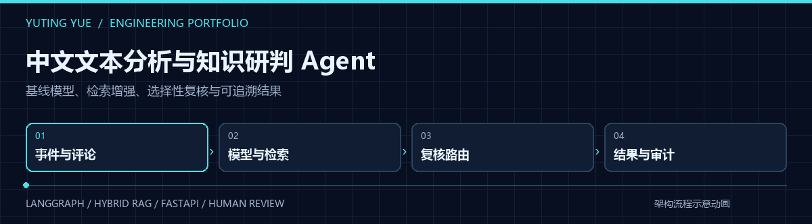
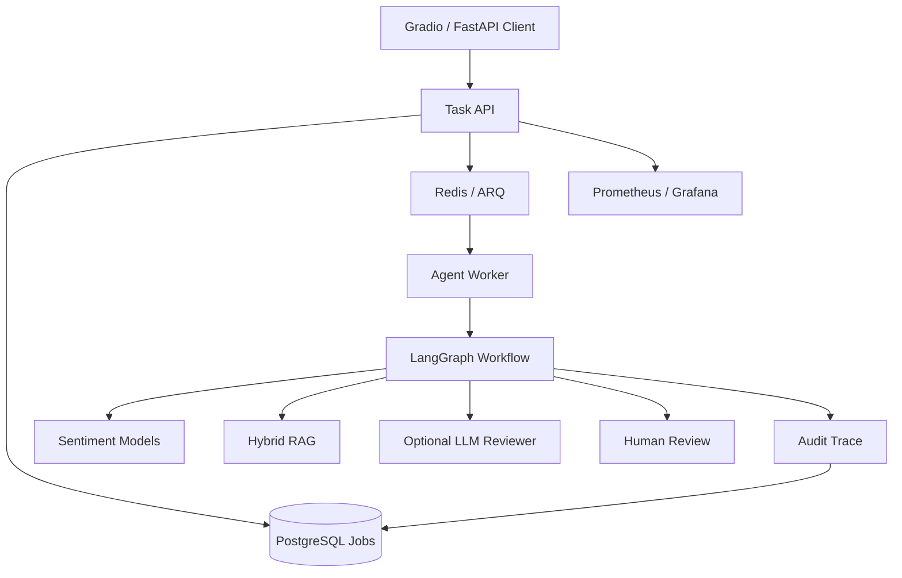

# 中文文本分析与知识研判 Agent



<sub>架构流程示意动画 · [静态版本](docs/assets/overview.png) · 动画不作为实测结果。</sub>

[返回技术作品集](https://github.com/KristenYue/KristenYue) · [机器人业务](https://github.com/KristenYue/telecom-network-incident-agent/blob/main/docs/ROBOT_DELIVERY.md) · [原生模型 SDK](https://github.com/KristenYue/edge-device-verification-lab/tree/main/inference_sdk) · [车辆 Agent](https://github.com/KristenYue/telecom-network-incident-agent/blob/main/docs/VEHICLE_ADAPTER.md)


**Python · LangGraph · Hybrid RAG · FastAPI · 人工复核**

输入事件背景与中文评论，输出倾向标签、关联证据和风险解释；不确定样本转人工，修改结果保留审计记录。本项目是作品集中的 **AI 方法与业务应用证据**，与 [设备 Agent](https://github.com/KristenYue/telecom-network-incident-agent)共同展示检索、任务状态和结果追踪，业务数据与执行流程各自独立。

## 优先看这三件事

| 工程问题 | 技术设计 | 实际结果 |
|---|---|---|
| 未见事件下固定分类器失效 | 基线模型 + 事件背景 + Hybrid RAG + Reviewer | 6 个未见事件、339 条冻结评论，纯自动 Accuracy **31.27% → 56.05%** |
| 高风险输入不宜全部自动处理 | LangGraph 状态与条件路由；分歧、低置信、短文本或证据不足触发复核 | 选择性自动覆盖 **78.76%**，该子集准确率 **66.67%**；其余转人工 |
| 结果为什么这样判需要可解释 | 来源、检索排名、路由原因、人工修改与最终标签入 Trace | 可从结果反查证据与处理路径 |

[完整实验口径](docs/BENCHMARK_V1_5_RESULTS.md) · [系统文档](docs) · [在线演示](https://modelscope.cn/studios/KristenYue/public-opinion-agent-demo)

纯自动增益 **+24.78 个百分点**在同一分母上比较；选择性自动以自动处理子集为分母，不能直接当全量准确率。下面保留业务架构、模块、运行命令和原始说明。


---

## 系统架构



## 模块实现

| 模块 | 实现 |
|---|---|
| Text Intelligence | XGBoost 快速基线、辅助模型、可选 Transformer 与事件感知 Reviewer |
| Agent Workflow | LangGraph 状态、条件路由、人工复核、失败降级和最终简报 |
| Knowledge Retrieval | Sparse / Dense / Hybrid 检索、相关性门禁、来源与引用记录 |
| Task API | FastAPI、Job 状态、项目隔离、Token、幂等任务提交 |
| Async Execution | PostgreSQL、Redis/ARQ Worker、Lease、Heartbeat、Checkpoint |
| Human-in-the-loop | `manual_required → human_completed`，修改结果写回任务 |
| Observability | Trace、Prometheus、Grafana 与结构化错误 |
| Integration | Gradio Demo、FastAPI Console、MCP 工具入口 |

可复用的 Planner、工具注册、Checkpoint 与长任务恢复能力在独立的 [AI Agent Runtime](https://github.com/KristenYue/agent-runtime-quality-platform) 中持续演进；本仓库聚焦 NLP/RAG 业务工作流与研判证据。


## 运行方法

```powershell
python -m venv .venv
.\.venv\Scripts\python.exe -m pip install -e ".[dev]"
.\.venv\Scripts\python.exe -m pytest -q --basetemp .pytest-tmp
```

启动 Gradio Demo：

```powershell
.\.venv\Scripts\python.exe app.py
```

启动 FastAPI：

```powershell
.\.venv\Scripts\python.exe -m uvicorn opinion_agent.v2.api:app --host 127.0.0.1 --port 8000
```

完整八服务环境：

```powershell
docker compose up --build
```

部署、Token 和 Reviewer 配置见 [V2 Deployment](docs/V2_DEPLOYMENT.md) 与 [V2 API](docs/V2_API.md)。

## 源码与证据

| 内容 | 入口 |
|---|---|
| Agent / LangGraph | [src/opinion_agent/agent](src/opinion_agent/agent) |
| Hybrid RAG | [src/opinion_agent/retrieval](src/opinion_agent/retrieval) |
| Sentiment Models | [src/opinion_agent/sentiment](src/opinion_agent/sentiment) |
| V2 Job Platform | [src/opinion_agent/v2](src/opinion_agent/v2) |
| 系统架构 | [ARCHITECTURE.md](docs/ARCHITECTURE.md) |
| 跨事件结果 | [BENCHMARK_V1_5_RESULTS.md](docs/BENCHMARK_V1_5_RESULTS.md) |
| RAG 结果 | [RAG_EVALUATION_V1.md](docs/RAG_EVALUATION_V1.md) |
| 人工复核策略 | [REVIEWER_POLICY_VALIDATION_PROTOCOL.md](docs/REVIEWER_POLICY_VALIDATION_PROTOCOL.md) |
| Runtime 报告 | [runtime_eval_report_v1.json](data/evaluation/runtime_eval_report_v1.json) |
| 文档导航 | [docs/README.md](docs/README.md) |

## 实验口径与适用范围

- 评测数据为项目整理/合成的事件数据，不代表线上舆情总体分布。
- 73.75% 完整流程参考结果使用人工标签模拟被转人工样本，不是模型独立准确率，因此不作为首屏模型指标。
- RAG 专项集规模较小，无关证据拒绝率为 75%，仍存在已公开的关键词误命中。
- Reviewer 曾修正 85 个基线错误，也产生 1 个 harmful override，不能无条件覆盖基线。
- Runtime 使用 60 对版本化 case 校准任务契约与失败路径；这不是模型准确率，也不是生产 SLA。
- 无 LLM Key、响应不符合契约或置信度不足时，任务转人工，不伪造自动结果。
- 八服务 Compose 和 Runtime Case 证明工程链路可执行，不代表生产容量、SLA 或真实平台部署。
- 公开 Demo 使用合成事件卡，不包含微博 Cookie、API Key、用户标识或来源不明的企业数据。

详细测试、治理、故障恢复和 Bad Case 已迁移到 [Agent Evaluation](docs/AGENT_EVALUATION.md)、[Security Governance](docs/V2_SECURITY_GOVERNANCE.md)、[Recovery](docs/V2_RECOVERY.md) 与 [Engineering Log](docs/V2_ENGINEERING_LOG.md)。

## 许可 & Data Boundary

第三方依赖及模型资产见 [THIRD_PARTY_NOTICES.md](THIRD_PARTY_NOTICES.md)，公开范围与上游来源见 [UPSTREAM.md](UPSTREAM.md)，数据边界见 [DATA_CARD.md](DATA_CARD.md)。
