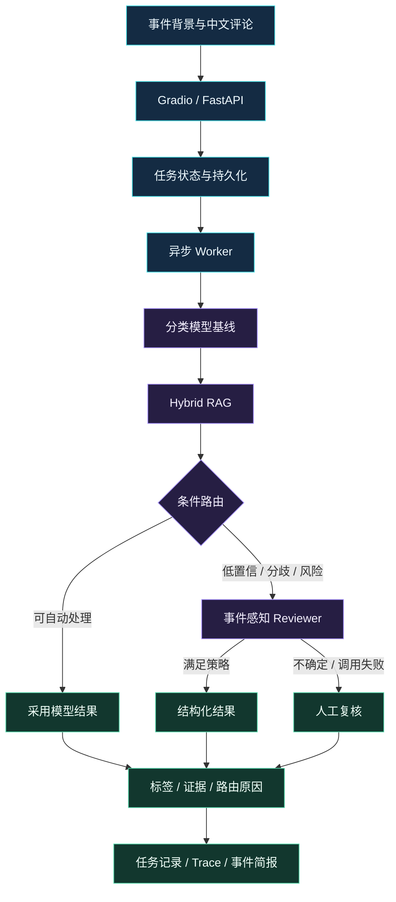
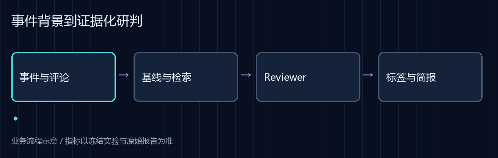
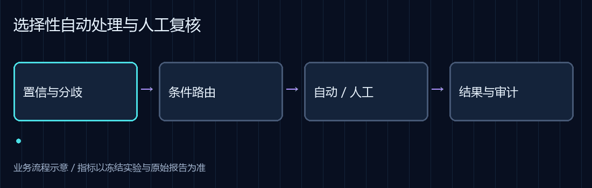

# 中文文本分析与知识研判 Agent

**Python · LangGraph · Hybrid RAG · FastAPI · PostgreSQL · Redis / ARQ · 人工复核**

[个人技术作品集](https://github.com/KristenYue) · [系统架构](docs/ARCHITECTURE.md) · [跨事件实验](docs/BENCHMARK_V1_5_RESULTS.md) · [在线演示](https://modelscope.cn/studios/KristenYue/public-opinion-agent-demo)

输入事件背景与中文评论，系统结合分类模型、历史知识检索和事件感知 Reviewer，输出倾向标签、关联依据与事件简报；不确定样本进入人工复核，修改结果保留审计记录。

**项目主线：快速模型基线 → 检索补充上下文 → 条件路由与复核 → 可追踪结果。**

---

## 本项目证明什么

| 研发能力 | 项目落点 |
|---|---|
| **模型应用与错误分析** | 分类基线、跨事件数据隔离、类别指标与典型错误 |
| **RAG 应用开发** | Sparse / Dense / Hybrid 检索、相关性门禁、来源与引用记录 |
| **Agent 工作流** | LangGraph 状态、条件分支、Reviewer、人工复核与失败降级 |
| **应用后端** | FastAPI、异步任务、状态持久化、接口与历史结果 |
| **工程可解释性** | 保存模型建议、检索依据、路由原因与人工修改 |

本仓库聚焦文本智能与知识工作流。[工业设备 Agent](https://github.com/KristenYue/telecom-network-incident-agent)聚焦设备与技能接入，[Agent Runtime](https://github.com/KristenYue/agent-runtime-quality-platform)聚焦通用执行机制。

---

## 核心量化结果

冻结实验包含 **6 个训练时未见事件、339 条评论**。

| 策略 | Accuracy | Macro-F1 | Negative Recall | 自动覆盖率 |
|---|---:|---:|---:|---:|
| XGBoost 快速基线 | 31.27% | 26.17% | 17.36% | 100% |
| 事件感知纯自动流程 | **56.05%** | **45.13%** | **57.64%** | 100% |
| 选择性自动处理 | **66.67%** | **53.22%** | **70.09%** | **78.76%** |

- **同一全量测试集**：纯自动 Accuracy 提升 **24.78 个百分点**。
- **选择性自动策略**：自动处理 **78.76%**，其余 **21.24%** 转人工。
- 选择性自动指标以自动处理子集为分母，与全量指标分别报告。

[完整实验、数据划分与指标口径](docs/BENCHMARK_V1_5_RESULTS.md)

---

## 系统架构



---

## 场景一：从事件评论到证据化研判



> 业务流程示意动画；实际指标来自冻结实验，模型与 Reviewer 配置见实验文档。

### 问题：单条评论的字面情绪不等于事件立场

短文本、反讽和依赖背景的评论容易造成误判。固定语料上的分类表现，也不能直接代表新事件下的泛化效果。

系统保留低成本分类模型作为基线，通过事件背景、历史证据与 Reviewer 补充上下文。

### 核心处理链

```text
事件背景与评论
  → 文本分类基线
  → 历史事件检索
  → 风险与分歧判断
  → Reviewer 或人工处理
  → 标签、理由与事件简报
```

### 工程设计

| 问题 | 实现 | 作用 |
|---|---|---|
| 新事件上下文缺失 | 将事件背景与检索证据送入研判流程 | 减少仅凭词面判断 |
| 单一检索方式覆盖不足 | Sparse / Dense / Hybrid 检索 | 结合关键词与语义匹配 |
| 检索命中不等于可信证据 | 记录相关性门禁、来源、排名与引用状态 | 区分“检索到”与“实际采用” |
| 最终判断难以解释 | 保存基线预测、Reviewer 输出与路由原因 | 可以从结果追查处理路径 |

### 量化收益

同一 339 条跨事件冻结集：

- Accuracy：**31.27% → 56.05%**
- Macro-F1：**26.17% → 45.13%**
- Negative Recall：**17.36% → 57.64%**

该结果属于整个事件感知流程的对照，不将全部增益单独归因于 RAG。

[跨事件结果](docs/BENCHMARK_V1_5_RESULTS.md) · [检索实现](src/opinion_agent/retrieval)

---

## 场景二：选择性自动处理与人工复核



> 动画展示自动化与人工处理的协作；人工完成结果不计为模型独立准确率。

### 问题：增加模型调用不一定改善结果

Reviewer 可能修正基线错误，也可能错误覆盖原本正确的预测。因此系统需要根据输入与证据决定是否触发、是否采用、何时转人工。

### 路由设计

| 情况 | 处理方向 |
|---|---|
| 满足自动处理策略 | 保留自动结果 |
| 低置信、模型分歧、短文本或高风险 | 进入 Reviewer 分支 |
| Reviewer 满足采用条件 | 写入结构化结果 |
| 证据不足、调用失败或输出不符合契约 | 转人工复核 |
| 人工修正 | 保存意见、最终标签与修改记录 |

`AgentState` 保存事件、评论、基线预测、检索证据、Reviewer 输出、路由原因和最终状态。

人工处理通过 `manual_required → human_completed` 状态流转，避免把“等待人工”和“任务完成”混在一起。

### 量化结果

选择性自动处理覆盖 **78.76%** 的样本：

| 指标 | 自动处理子集结果 |
|---|---:|
| Accuracy | **66.67%** |
| Macro-F1 | **53.22%** |
| Negative Recall | **70.09%** |
| 转人工比例 | **21.24%** |

这些指标用于观察**自动覆盖与准确性的取舍**，不与全量自动流程使用相同分母。

[复核策略协议](docs/REVIEWER_POLICY_VALIDATION_PROTOCOL.md) · [Agent 实现](src/opinion_agent/agent)

---

## 任务平台与应用交付

| 模块 | 完成的工作 |
|---|---|
| **API** | FastAPI 接单、任务查询、项目隔离、Token 与幂等提交 |
| **异步执行** | PostgreSQL 任务存储、Redis / ARQ Worker、状态与 Checkpoint |
| **人工交互** | 查看原文、模型建议和证据，提交复核结果 |
| **可观测性** | 结构化错误、Trace、Prometheus / Grafana 接入 |
| **演示入口** | Gradio、FastAPI Console 与 MCP 工具入口 |

这些模块为业务工作流提供运行环境；平台代码、模型效果与部署验证分别核查。

[部署说明](docs/V2_DEPLOYMENT.md) · [API 文档](docs/V2_API.md) · [任务平台源码](src/opinion_agent/v2)

---

## 源码与证据链

| 想核查的内容 | 入口 |
|---|---|
| 分类模型与接口 | [sentiment](src/opinion_agent/sentiment) |
| Agent 状态与路由 | [agent](src/opinion_agent/agent) |
| Hybrid RAG | [retrieval](src/opinion_agent/retrieval) |
| 异步任务与 API | [v2](src/opinion_agent/v2) |
| 系统架构 | [ARCHITECTURE.md](docs/ARCHITECTURE.md) |
| 跨事件冻结结果 | [BENCHMARK_V1_5_RESULTS.md](docs/BENCHMARK_V1_5_RESULTS.md) |
| RAG 专项结果 | [RAG_EVALUATION_V1.md](docs/RAG_EVALUATION_V1.md) |
| 复核策略 | [REVIEWER_POLICY_VALIDATION_PROTOCOL.md](docs/REVIEWER_POLICY_VALIDATION_PROTOCOL.md) |
| 工程日志 | [V2_ENGINEERING_LOG.md](docs/V2_ENGINEERING_LOG.md) |

---

## 运行方法

Python 虚拟环境：

```powershell
python -m venv .venv
.\.venv\Scripts\python.exe -m pip install -e ".[dev]"
.\.venv\Scripts\python.exe -m pytest -q --basetemp .pytest-tmp
```

启动 Gradio：

```powershell
.\.venv\Scripts\python.exe app.py
```

启动 FastAPI：

```powershell
.\.venv\Scripts\python.exe -m uvicorn opinion_agent.v2.api:app --host 127.0.0.1 --port 8000
```

容器部署入口：

```bash
docker compose up --build
```

模型、Reviewer、Token 与服务配置见 [部署文档](docs/V2_DEPLOYMENT.md)。真实模型功能需要对应服务配置；离线与降级模式不作为真实模型调用证据。

---

## 工程复盘与 Bad Case

| 问题 | 方法与处理 |
|---|---|
| 随机划分表现不能代表新事件 | 使用未见事件冻结集，隔离同事件信息 |
| 基线对短文本与背景依赖表达失效 | 引入事件上下文、检索与复核分支 |
| Reviewer 错误覆盖正确预测 | 采用条件路由与覆盖策略，保留错误覆盖案例 |
| 关键词相近但实际无关 | 检查检索来源、相关性门禁与最终引用 |
| 模型服务失败或输出非法 | 明确转人工，不伪造自动结果 |
| 人工与自动成绩混算 | 分别报告全量自动、选择性自动与人工处理 |

[评估与错误分析](docs/AGENT_EVALUATION.md) · [故障恢复](docs/V2_RECOVERY.md) · [数据说明](DATA_CARD.md)

---

<details>
<summary>实验口径与数据范围</summary>

项目事件数据不代表线上舆情总体分布。跨事件实验与历史随机划分分别报告，不能直接比较。

选择性自动指标以自动处理子集为分母；人工标签模拟的完整流程结果不作为模型独立准确率。

RAG 专项集规模有限，保留无关证据误命中等失败案例。部署与任务契约验证不等同于生产容量或 SLA。

公开演示采用合成事件卡，不包含来源不明的企业数据、用户标识或凭据。

</details>

---

[第三方依赖与模型资产](THIRD_PARTY_NOTICES.md) · [来源与扩展边界](UPSTREAM.md) · [数据说明](DATA_CARD.md)
