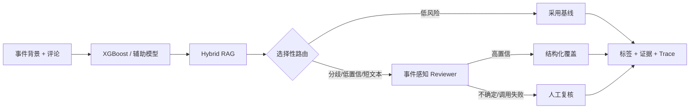
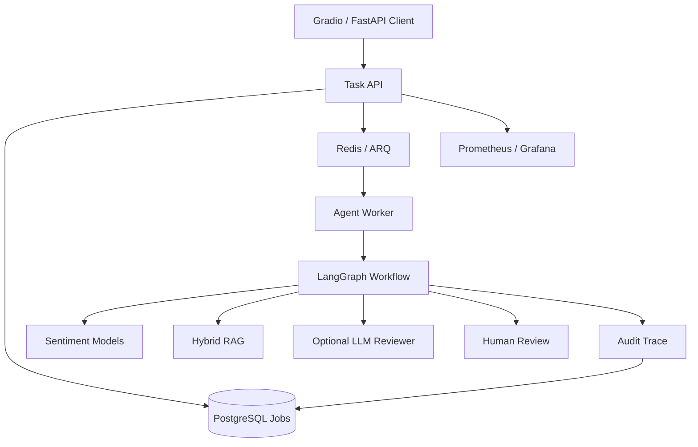

# NLP & RAG Agent — 文本智能分析与知识研判系统

[](https://github.com/KristenYue/public-opinion-agent-eval/actions/workflows/ci.yml)

`Python` · `LangGraph` · `FastAPI` · `Hybrid RAG` · `PostgreSQL` · `Redis`

## Project Overview

输入事件背景与中文评论，系统调用情感分析、历史事件检索和事件感知 Reviewer，生成评论倾向、关联证据、风险原因和事件简报。对低置信、模型分歧、短文本或证据不足的输入，Agent 会转入人工复核；人工修改写回任务并保留审计记录。

项目从本科阶段的 XGBoost 情感分类器发展而来。旧模型对固定语料处理成本低，但面对未见事件、反讽和依赖背景的短评论时容易失效。因此系统保留 XGBoost 作为快速基线，用 Hybrid RAG 补充历史上下文，再由 LangGraph 路由 Reviewer 与人工处理。

[在线演示](https://modelscope.cn/studios/KristenYue/public-opinion-agent-demo) · [3 分钟离线演示](docs/舆情研判Agent_3分钟离线演示.mp4)

## Application Scenarios

| 场景 | 系统功能 | 输出 |
|---|---|---|
| 新事件评论研判 | 结合事件背景判断评论倾向，不只依赖关键词 | 标签、置信度、风险原因 |
| 历史知识检索 | Sparse + Dense Hybrid RAG 检索相似事件证据 | 证据来源、排名、相关性与引用状态 |
| 选择性自动处理 | 对低风险输入自动完成，对不确定输入转人工 | 自动/人工状态与路由原因 |
| 人工复核 | 查看原文、模型建议和证据后修正结果 | 修改记录、复核意见和最终简报 |
| 异步批量任务 | FastAPI 接单，Worker 执行并保存任务状态 | Job 状态、Checkpoint、Trace 与指标 |

## Features & Real Demonstration

### 一条评论如何完成研判



`AgentState` 保存事件、评论、基线预测、检索证据、Reviewer 输出、路由原因、人工状态和最终标签。因此系统能够回答：为什么触发 Reviewer、用了哪些证据、为什么转人工以及最终由谁修改。

### 同一未见事件测试集上的结果

冻结测试包含 6 个训练时未见事件、339 条评论：

| 策略 | Accuracy | Macro-F1 | Negative Recall | 自动覆盖率 |
|---|---:|---:|---:|---:|
| XGBoost 快速基线 | 31.27% | 26.17% | 17.36% | 100% |
| 事件感知纯自动流程 | 56.05% | 45.13% | 57.64% | 100% |
| 选择性自动 | 66.67% | 53.22% | 70.09% | 78.76% |

纯自动流程比旧基线提升 **24.78 个百分点**。选择性自动的准确率只以自动处理样本为分母，其余 **21.24%** 明确转人工；两种口径不混用。[完整跨事件结果](docs/BENCHMARK_V1_5_RESULTS.md)

### Hybrid RAG

检索链路融合关键词/事件实体与语义相似度，保留来源事件、排名、分数、门禁和最终引用状态。公开合成专项集包含 16 条相关查询、4 条无关查询和 3 条检索污染查询；一个“快速排序算法”误命中“配送算法规则调整”的失败案例被保留，用于说明关键词重叠风险。

## System Architecture



## Core Implementation

| 模块 | 实现 |
|---|---|
| Text Intelligence | XGBoost 快速基线、辅助模型、可选 Transformer 与事件感知 Reviewer |
| Agent Workflow | LangGraph 状态、条件路由、人工复核、失败降级和最终简报 |
| Knowledge Retrieval | Sparse / Dense / Hybrid 检索、相关性门禁、来源与引用记录 |
| Task API | FastAPI、Job 状态、项目隔离、Token、幂等任务提交 |
| Async Execution | PostgreSQL、Redis/ARQ Worker、Lease、Heartbeat、Checkpoint |
| Human-in-the-loop | `manual_required → human_completed`，修改结果写回任务 |
| Observability | Trace、Prometheus、Grafana 与结构化错误 |
| Integration | Gradio Demo、FastAPI Console、MCP 工具入口 |

可复用的 Planner、工具注册、Checkpoint 与长任务恢复能力在独立的 [AI Agent Runtime](https://github.com/KristenYue/agent-runtime-quality-platform) 中持续演进；本仓库聚焦 NLP/RAG 业务工作流与研判证据。

## Engineering Results

| 业务/工程结果 | 当前证据 |
|---|---|
| 新事件上下文建模 | 599 条评论、12 个事件；最终测试为 6 个未见事件、339 条评论 |
| 纯自动研判改善 | Accuracy 31.27% → 56.05%，同一冻结测试集 |
| 选择性自动 | 自动部分 66.67% Accuracy、78.76% 覆盖率，其余转人工 |
| 历史知识检索 | 相关查询 Recall@5 100%；无关查询拒绝率 75%，保留误命中 |
| 人工复核闭环 | 修改最终标签和意见后重新生成简报并写入审计状态 |
| 异步 Agent 服务 | PostgreSQL Job、Redis Worker、Checkpoint、Trace 和八服务 Compose |
| 可复现交付 | [CI Run 38899760131](https://github.com/KristenYue/public-opinion-agent-eval/actions/runs/38899760131) 保存构建与 Compose 验证记录 |

## Industry Applications

- **半导体与 AI 芯片：** 研发文档检索、问题单归类、日志与知识辅助研判。
- **智能汽车：** 用户反馈分析、研发知识检索、车端问题评论与人工复核工作流。
- **具身智能：** 机器人运行记录、任务日志、知识检索和异常文本归因。

以上是 NLP/RAG 能力的迁移方向；仓库没有使用真实企业工单、车辆数据或机器人生产日志。

## Quick Start

```powershell
python -m venv .venv
.\.venv\Scripts\python.exe -m pip install -e ".[dev]"
.\.venv\Scripts\python.exe -m pytest -q --basetemp .pytest-tmp
```

启动 Gradio Demo：

```powershell
.\.venv\Scripts\python.exe app.py
```

启动 FastAPI：

```powershell
.\.venv\Scripts\python.exe -m uvicorn opinion_agent.v2.api:app --host 127.0.0.1 --port 8000
```

完整八服务环境：

```powershell
docker compose up --build
```

部署、Token 和 Reviewer 配置见 [V2 Deployment](docs/V2_DEPLOYMENT.md) 与 [V2 API](docs/V2_API.md)。

## Evidence & Source Code

| 内容 | 入口 |
|---|---|
| Agent / LangGraph | [src/opinion_agent/agent](src/opinion_agent/agent) |
| Hybrid RAG | [src/opinion_agent/retrieval](src/opinion_agent/retrieval) |
| Sentiment Models | [src/opinion_agent/sentiment](src/opinion_agent/sentiment) |
| V2 Job Platform | [src/opinion_agent/v2](src/opinion_agent/v2) |
| 系统架构 | [ARCHITECTURE.md](docs/ARCHITECTURE.md) |
| 跨事件结果 | [BENCHMARK_V1_5_RESULTS.md](docs/BENCHMARK_V1_5_RESULTS.md) |
| RAG 结果 | [RAG_EVALUATION_V1.md](docs/RAG_EVALUATION_V1.md) |
| 人工复核策略 | [REVIEWER_POLICY_VALIDATION_PROTOCOL.md](docs/REVIEWER_POLICY_VALIDATION_PROTOCOL.md) |
| Runtime 报告 | [runtime_eval_report_v1.json](data/evaluation/runtime_eval_report_v1.json) |
| 文档导航 | [docs/README.md](docs/README.md) |

## Validation & Limitations

- 评测数据为项目整理/合成的事件数据，不代表线上舆情总体分布。
- 73.75% 完整流程参考结果使用人工标签模拟被转人工样本，不是模型独立准确率，因此不作为首屏模型指标。
- RAG 专项集规模较小，无关证据拒绝率为 75%，仍存在已公开的关键词误命中。
- Reviewer 曾修正 85 个基线错误，也产生 1 个 harmful override，不能无条件覆盖基线。
- Runtime 使用 60 对版本化 case 校准任务契约与失败路径；这不是模型准确率，也不是生产 SLA。
- 无 LLM Key、响应不符合契约或置信度不足时，任务转人工，不伪造自动结果。
- 八服务 Compose 和 Runtime Case 证明工程链路可执行，不代表生产容量、SLA 或真实平台部署。
- 公开 Demo 使用合成事件卡，不包含微博 Cookie、API Key、用户标识或来源不明的企业数据。

详细测试、治理、故障恢复和 Bad Case 已迁移到 [Agent Evaluation](docs/AGENT_EVALUATION.md)、[Security Governance](docs/V2_SECURITY_GOVERNANCE.md)、[Recovery](docs/V2_RECOVERY.md) 与 [Engineering Log](docs/V2_ENGINEERING_LOG.md)。

## License & Data Boundary

第三方依赖及模型资产见 [THIRD_PARTY_NOTICES.md](THIRD_PARTY_NOTICES.md)，公开范围与上游来源见 [UPSTREAM.md](UPSTREAM.md)，数据边界见 [DATA_CARD.md](DATA_CARD.md)。
