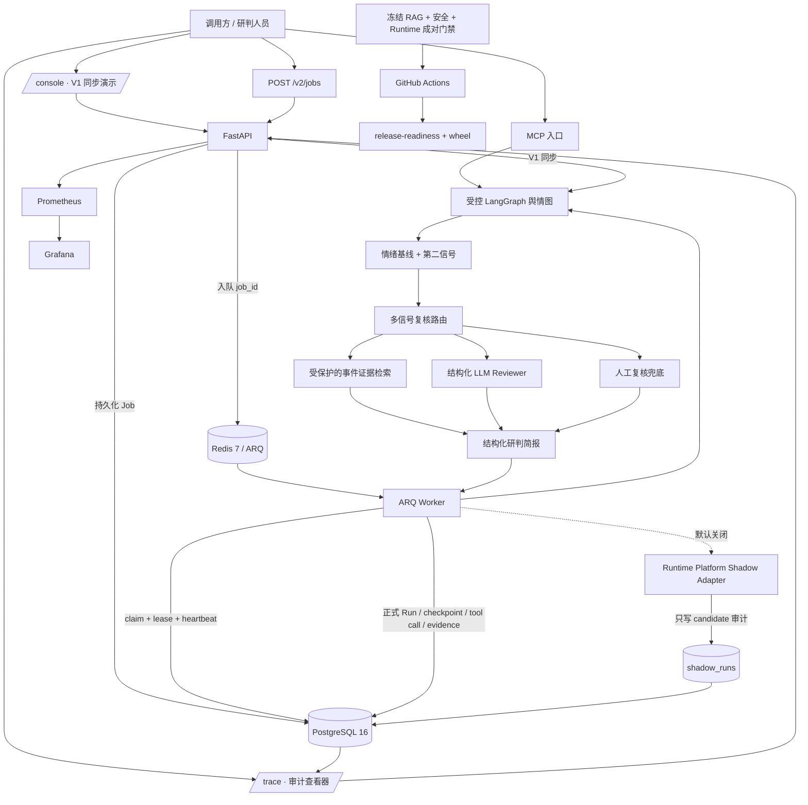
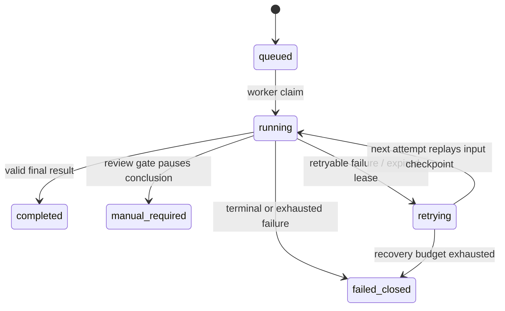
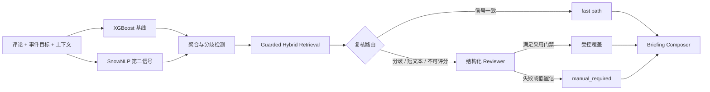

# 最终系统架构

本文描述 `production-v2` 当前可验证架构。历史实验、冻结指标和早期 Week 2 实现记录不是当前运行拓扑；API 细节以 [V2_API.md](V2_API.md) 为准。

## 1. 总体拓扑

## 2. 两条请求路径

### V1：同步展示路径

`POST /v1/analyze` 直接调用现有 LangGraph，适合公开合成 Demo 和面试时展示业务决策。它返回同一份结构化简报契约，无论 Reviewer 成功、降级或转人工。`/console` 展示情绪结构、证据、复核队列和本次同步运行的工具轨迹。

### V2：可恢复生产路径

`POST /v2/jobs` 先把规范化、脱敏后的请求写入 PostgreSQL，再把 Job ID 交给 Redis/ARQ。Worker 通过 compare-and-set 领取任务，写入版本快照与 `input_replay` checkpoint，并通过 lease/heartbeat 声明当前所有权。最终状态与每个运行尝试都以 PostgreSQL 为事实源。

这里的“暂停”是 `manual_required`，表示不自动形成最终结论并等待人工复核；这里的“恢复”是从已校验哈希的输入 checkpoint 重放，不是 LangGraph 任意节点续跑。

## 3. Agent 决策图

检索采用字符 TF-IDF、BGE-small-zh-v1.5 和 reciprocal-rank fusion，并在输出前执行相关性与 Prompt Injection 防护。证据只提供可追溯上下文，不被描述为因果证明。

## 4. 审计数据与隔离边界

| 数据 | PostgreSQL 事实表 | 作用 |
|---|---|---|
| Job 生命周期 | `analysis_jobs` | 状态、错误、尝试数、租约和恢复数 |
| 正式运行 | `agent_runs` | trace ID、版本快照、输入/输出、Token、恢复原因 |
| 恢复边界 | `run_checkpoints` | 输入、完成或失败状态及 SHA-256 |
| 工具轨迹 | `tool_calls` | 顺序、节点、请求/响应、耗时和错误 |
| 检索证据 | `retrieved_evidence` | 排名、后端、分数、来源和接受状态 |
| 人工复核 | `human_reviews` | 原标签、最终标签、理由和审核身份 |
| 候选运行 | `shadow_runs` | 与正式结果隔离的 Runtime candidate 结果 |

Shadow 默认关闭。启用后使用输入深拷贝，启动失败、超时、candidate 异常和 sink 异常都不会修改正式 Job；candidate 没有调用正式 `finish_execution` 的能力。关闭 `RUNTIME_SHADOW_ENABLED` 并重启 Worker 即可停止新增 Shadow 执行，历史记录保留审计。

## 5. 可观测性与质量门禁

- API 为每个 HTTP 请求生成或回传 `X-Request-ID`，Worker 日志使用 Job ID、Run ID 和 Trace ID；三者不混用。
- `/health` 只证明进程存活；`/ready` 实际探测 PostgreSQL 与 Redis；`/metrics` 提供低基数 Prometheus 指标。
- 60 条公开合成 Runtime 任务对 baseline/candidate 做成功率、质量、错误、延迟和估算成本五维比较。
- 冻结 RAG 门禁、安全故障注入、Runtime 成对门禁、release-readiness 和 wheel 内容检查在同一 CI 中串联。
- PostgreSQL/Redis job 实际应用三份 migration，并验证幂等 Job、claim、heartbeat、正式结果、Trace 读回和 Shadow 隔离。

## 6. 当前明确边界

1. Runtime 报告是合成契约校准，不是生产流量、真实成本或 SLA。
2. 当前恢复粒度是输入重放，不是节点级继续执行。
3. `requested_by` 尚未由认证身份覆盖；Trace 包含业务审计数据，接入非受信网络前必须增加认证与 Project 级授权。
4. 本机尚无 Docker 全量 Compose 实跑证据；真实 PostgreSQL/Redis 证据来自 GitHub Actions service containers。
5. 通信故障诊断、FSO adapter 和 Multi-Agent 均在 P3 交付闭环之后，不属于当前主线。
