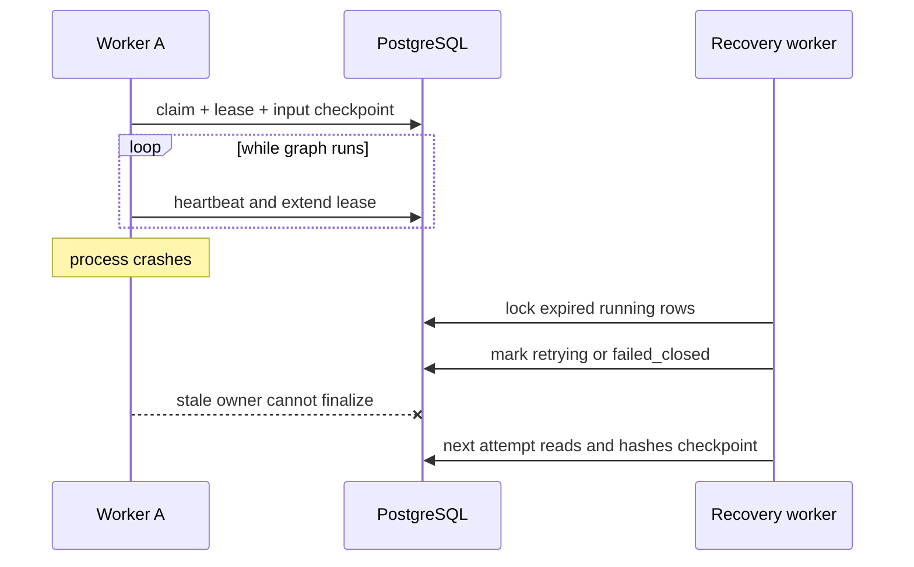

# V2 lease and replay recovery

## What this version guarantees

1. A worker atomically claims only a `queued` or `retrying` job.
2. The claim records a worker identity and an expiring lease.
3. A live worker renews the lease while the synchronous Agent graph runs.
4. Every attempt stores a hash-protected `input_replay` checkpoint before graph
   execution.
5. A stale lease can be recovered to `retrying`, or to `failed_closed` after the
   attempt budget is exhausted.
6. A retry reads the previous input checkpoint and verifies SHA-256 before it
   starts. Missing or modified checkpoints fail rather than silently falling
   back to another input.
7. Final writes include the lease owner, so an old worker cannot overwrite a
   result after ownership has moved elsewhere.



## Configuration

```text
JOB_LEASE_SECONDS=60
JOB_HEARTBEAT_INTERVAL_SECONDS=20
JOB_MAX_ATTEMPTS=3
WORKER_ID=optional-stable-worker-name
```

The heartbeat interval must be shorter than the lease.

## Migration behavior

`scripts/apply_v2_migrations.py` now creates `schema_migrations`, discovers all
packaged numbered SQL files, sorts them by filename and applies each migration
once in its own transaction.

## Exact limitation: replay is not node-level resume

The current `build_opinion_graph()` calls `builder.compile()` without a durable
LangGraph checkpointer. Consequently this version restarts a failed attempt from
the verified initial Agent state. It does not resume after
`evidence_retriever`, `review_router`, or another internal node.

True node-level resume requires a PostgreSQL-compatible LangGraph checkpointer,
a stable `thread_id`, checkpoint cleanup rules and an integration test that
kills the worker between two nodes. Until that exists, project descriptions
must use “lease-based replay recovery”, not “node-level checkpoint resume”.

## Remaining integration proof

Docker is unavailable on the current machine. The SQL migration, real lease
expiry, concurrent claim and Redis redelivery behavior still require service
container tests in CI or on a Docker-enabled host.
