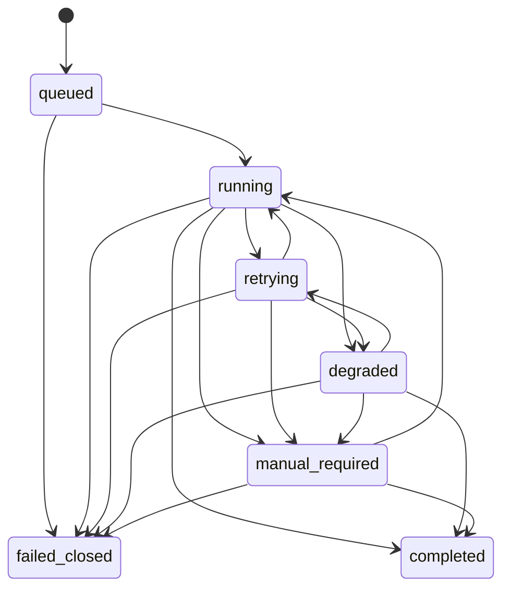

# Production V2 Week 1 baseline

> 历史实现检查点：本文保留 Week 1 当时的范围与未完成项，不再作为当前状态说明。当前契约见 [V2_API.md](V2_API.md)，最终拓扑见 [ARCHITECTURE.md](ARCHITECTURE.md)，完整部署证据见 [V2_DEPLOYMENT.md](V2_DEPLOYMENT.md)。

This document starts a new production track without changing the frozen V1
benchmark, its data, or its reported metrics.

## Scope frozen in this baseline

- PostgreSQL tables for projects, jobs, comments, evidence, runs, tool calls,
  human reviews, and versioned executable components.
- An explicit job state machine shared by the future API, worker, and review UI.
- A run-start snapshot covering model, prompt, toolset, and policy versions.
- Idempotency constraints for job submission and human-review submission.
- Replay inputs and outputs stored as JSONB while important query fields remain
  first-class columns.

## Job lifecycle

`completed` and `failed_closed` are terminal. A corrected human review is a new,
idempotent review record; it must not silently reopen a terminal job.

## Week 2 handoff status

The PostgreSQL repository and asynchronous API contract are now implemented:

1. `POST /v2/jobs` normalizes input, claims an idempotency key, writes a queued
   job and returns `202` with `job_id`.
2. `GET /v2/jobs/{job_id}` returns status and a safe result projection.
3. PostgreSQL and Redis are required together; partial configuration fails fast.

The Worker code now claims the job, creates an `agent_runs` row, captures the
version snapshot before graph invocation and persists traces/results. Real
PostgreSQL/Redis integration tests remain pending because Docker is unavailable
on the current machine.
